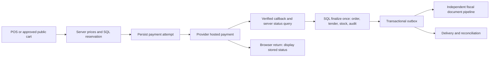

# MIRO commerce architecture and implementation map

Research baseline: 2026-10-06. **Proposed implementation; no payment gateway, expense system or independent fiscal engine was added by this research.** Start with `../LUNA_COMMERCE_PROMPT.md`; acceptance lives in `POS_AND_ACCEPTANCE.md` and verified external facts in `PROVIDERS_AND_ISRAEL.md`.

## Repository state and existing behavior

- Local `main`: `fdec25c11dabe77ffa74108bb2da1f15c241bd21` (2026-10-05). Earlier local POS integration commit: `8855ec1`. Read-only `git ls-remote origin` on the research date returned remote `main`/HEAD `be87819543734c8392fefd61600d5ed04171bf59`. Local and remote are different; no pull, push or deployment occurred. Recheck before implementing.
- Package 0.1.0: Next.js 16.3.8, React 19.2.8, TypeScript 5, next-intl, Supabase SSR/Postgres/Storage, Tailwind 4, Zod, Lucide, Playwright and axe. Preserve this stack; do not add a second auth/database/UI architecture.
- The dirty workspace includes POS/calculator changes and `20261005030000_fix_management_pos_accounts.sql`. It is not safe to reset, reseed inventory or assume linked production has this migration.
- The public store supports Hebrew/English and dark/medium/light. Reference products with unapproved prices/stock remain quote-only. Checkout currently persists an enquiry/request, without an order, reservation or gateway charge.
- POS records a completed sale through authenticated `/api/management/sales` → `record_pos_sale`. It atomically writes order/items/payments/stock/audit. Selecting `credit_card` or `bit` currently records an operator-declared payment; it does **not** contact a payment provider. Missing payment rows currently default to full cash. Neither behavior can be used for asynchronous gateway checkout.
- Accounts already display orders, payments and rudimentary `invoices`. Finance derives sales, VAT, COGS and gross profit from orders; it excludes operating expenses and is not a complete ledger or statutory financial report.
- The runtime fix places `OverlayStackProvider` above `ManagementToolProvider` because floating tools render alongside that provider's children. Preserve this ordering and the overlay regression tests.

## Read/edit map: existing files

| Concern            | Existing entry points                                                                                                                                                                                                                          | Implementation instruction                                                                                                                  |
| ------------------ | ---------------------------------------------------------------------------------------------------------------------------------------------------------------------------------------------------------------------------------------------- | ------------------------------------------------------------------------------------------------------------------------------------------- |
| POS                | `src/components/management/tools/pos/pos-window.tsx`, `pos-copy.ts`, `pos-window.module.css`                                                                                                                                                   | Extend/refactor into payment/cart/customer/history components; do not fork a second POS                                                     |
| Window behavior    | `src/components/management/tools/floating-workspace-window.tsx`, its CSS, `management-tool-provider.tsx`, `floating-tool-windows.tsx`, `tool-types.ts`                                                                                         | Draft and window persistence, fullscreen/focus coordination                                                                                 |
| Overlay hierarchy  | `src/components/management/shell/management-shell.tsx`, `src/components/management/ui/overlay-stack.tsx`, `dialog.tsx`, `drawer.tsx`                                                                                                           | Shared provider and portal remain visible inside fullscreen                                                                                 |
| Navigation         | `src/components/management/shell/nav-config.ts`, `workspace-tools.tsx`, `management-topbar.tsx`                                                                                                                                                | Add Documents/Expenses where appropriate; preserve role-based navigation                                                                    |
| Sale contract      | `src/app/api/management/sales/route.ts`, `src/lib/pos-sale.ts`, `src/lib/sales-channel.ts`, `src/components/management/sales-types.ts`, `sales-panel.tsx`                                                                                      | Separate recorded external tender from provider-collected tender; keep server-owned source                                                  |
| Account history    | `src/app/api/management/accounts/route.ts`, `[orderId]/route.ts`, `src/components/management/accounts/accounts-dashboard.tsx`, `accounts-copy.ts`                                                                                              | One canonical projection of payments/documents/refunds, correct permissions                                                                 |
| Reporting          | `src/app/api/management/finance/route.ts`, `analytics/route.ts`, `src/components/management/finance-dashboard.tsx`, `src/lib/management-reporting.ts`, `report-insights.ts`                                                                    | Add clearly scoped expense/cash/settlement views; preserve historical metric definitions                                                    |
| Business settings  | `src/app/api/management/settings/route.ts`, `settings/animation/route.ts`, `src/components/management/settings-panel.tsx`, `ceo-settings.tsx`                                                                                                  | Dedicated versioned commerce/document settings; existing animation path is an authorization/revision pattern, not a place for commerce data |
| Tax/pricing        | `src/app/api/management/tax/route.ts`, `src/lib/catalog/pricing.ts`, `src/lib/store-data.ts`                                                                                                                                                   | Effective tax snapshots and canonical server prices                                                                                         |
| Public checkout    | `src/features/cart/cart-context.tsx`, `checkout-page-client.tsx`, `cart-copy.ts`, `src/app/[locale]/(public)/checkout/page.tsx`, `src/app/api/enquiries/route.ts`                                                                              | Preserve enquiry path; add a separate real checkout when approved/enabled                                                                   |
| Authorization/data | `src/lib/auth.ts`, `permissions.ts`, `src/app/api/management/_shared.ts`, `src/lib/supabase/server.ts`, `admin.ts`, `database.types.ts`                                                                                                        | User-context access by default; narrow service-only webhook/jobs, never browser secrets                                                     |
| SQL                | `supabase/migrations/20261005010000_fix_record_pos_sale.sql`, `20261005030000_fix_management_pos_accounts.sql`, `supabase/migrations/20260920151303_init_miro_schema.sql`, `supabase/tests/`                                                   | Additive migrations after latest timestamp; source of truth is migrations, not old audit prose                                              |
| Verification       | `scripts/verify-database.py`, `verify-management-tools.mjs`, `verify-business-console.mjs`, `verify-reporting-workspaces.mjs`, `tests/unit/`, `tests/store-cart.spec.ts`, `tests/store-overlays.spec.ts`, `playwright.cross-browser.config.ts` | Reuse fixtures/cleanup; preserve historical evidence through output-directory overrides                                                     |

Paths in the next sections are **new proposals**, not existing implementations. Agree on exact contracts with the SQL owner before parallel edits; deviations need an ADR and updated map.

Historical notes mention `supabase/schema.sql`, but that file is absent in the current tree. Start with the initial migration and apply the full ordered migration history; do not recreate an obsolete monolithic schema from an old handoff.

## Boundaries and common contracts

Create `src/lib/commerce/` with server-only application services and pure domain helpers:

| Proposed module                                                        | Contract                                                                                                                                                                       |
| ---------------------------------------------------------------------- | ------------------------------------------------------------------------------------------------------------------------------------------------------------------------------ |
| `money.ts`, `types.ts`, `validation.ts`                                | ILS integer agorot at API/domain boundaries; safe integers and positive bounds, never floating-point totals. SQL exact numeric/integer representation with explicit conversion |
| `checkout-service.ts`, `inventory-reservations.ts`                     | Canonical quote, price/tax/customer snapshot, hold/expiry/finalization and actor-scoped idempotency                                                                            |
| `payments/gateway.ts`, `payments/payplus.ts`, `payments/simulator.ts`  | `createHostedSession`, `verifyNotification`, `queryPayment`, `refund`, capability/config validation; optional token/terminal/capture only when supported                       |
| `payments/reconciliation.ts`                                           | Unknown/late/duplicate results, refunds, settlement reconciliation and operator exceptions                                                                                     |
| `documents/issuer.ts`, `documents/numbering.ts`, `documents/render.ts` | Independent issuer is the default; no obligatory invoice SaaS. Immutable fiscal snapshots and deterministic artifacts                                                          |
| `documents/signer.ts`, `documents/allocation.ts`                       | Separate electronic-signature and Israel Tax Authority allocation interfaces; explicit configured/unavailable/pending/rejected/unknown results                                 |
| `expenses/service.ts`, `reporting.ts`                                  | Expense lifecycle, permission-checked reporting and explicit accounting scope                                                                                                  |
| `jobs/outbox.ts`                                                       | SQL-backed durable jobs, leases, bounded backoff, idempotent effect keys and exception queue                                                                                   |

`PaymentGateway.capabilities` must be server-resolved for the actual environment/account: hosted card, bit, installments, authorize/capture, partial refund, recurring, terminal, settlement lookup and an explicitly approved no-obligo product. A dropdown cannot grant these capabilities. Do not expose a boolean `success` that erases failed/unknown/authorized/captured distinctions. Preserve provider request UID separately from transaction UID; provider response IDs must come from validated responses, not browser input.

All mutations have actor/intent-scoped idempotency keys and canonical payload hashes. Same key + same payload returns the same result; same key + changed payload yields a conflict. Idempotency keys are not authentication. Enforce request size limits, schema validation, rate limiting, same-origin for browser writes and authorization again inside SQL. Webhooks are external, so use provider verification instead of a browser same-origin guard.

## Proposed storage and migration strategy

Use existing orders/items/stock ledger as canonical completed-sale data. Do not create competing sales totals or double-decrement stock. New schema proposals:

| Tables / extension                                                                                                                               | Key invariants                                                                                                                                                      |
| ------------------------------------------------------------------------------------------------------------------------------------------------ | ------------------------------------------------------------------------------------------------------------------------------------------------------------------- |
| `commerce_intents`, `commerce_intent_items`                                                                                                      | Immutable priced/tax snapshots per revision, source/channel, customer snapshot, currency, expiry, actor/customer ownership, payload hash                            |
| `stock_reservations`                                                                                                                             | Variant and intent quantities, expires_at, active/consumed/released; lock variants in stable order; available = on-hand minus active holds                          |
| `payment_attempts`                                                                                                                               | Intent/tender association, provider+environment+merchant identity, request/transaction IDs, amount, state, idempotency and timestamps                               |
| `payment_events`                                                                                                                                 | Durable minimally retained verified event, unique provider event identity or deterministic fingerprint, replay-safe processing; sensitive payload retention bounded |
| `payment_refunds`, `settlement_entries`                                                                                                          | Refund amount never exceeds refundable captured balance; record fees/net deposits independently of sale totals; chargebacks separate                                |
| Extend `order_payments`                                                                                                                          | Provider attempt/transaction relation and truthful paid_at (nullable while pending); migrate existing recorded tenders without pretending gateway verification      |
| `document_business_versions`, `document_number_series`, `fiscal_documents`, `fiscal_document_items`, `document_artifacts`, `allocation_requests` | Entity/version/type/series/number, immutable snapshots, unique issue effect, linked correction, signed artifact/hash, allocation provenance                         |
| `expenses`, `expense_items`, `expense_attachments`, `expense_approvals`, `expense_payments`                                                      | Private evidence, supplier/document identity, approval lifecycle, deduplication signal, audited correction/void, links to payment evidence                          |
| `cash_sessions`, `cash_movements`, `cash_counts`, optional server `parked_sale_drafts`                                                           | Audited opening/closing/variance and authorized cash adjustments; actor-scoped resumable drafts with revision/expiry, never implicit stock holds                    |
| `commerce_outbox`, `commerce_operations_audit`                                                                                                   | Transactional task creation, lease/retry/quarantine, redact secrets, immutable monetary operation evidence                                                          |

Current `invoices.user_id` is NOT NULL and deletes on auth-user cascade. It is unsuitable for anonymous buyers and fiscal retention. Migration must remove destructive dependencies, preserve historical rows/numbers and provide a compatibility projection to existing account consumers. Decide either to evolve `invoices` into the canonical fiscal table or migrate it with an explicit compatibility view. Do **not** leave two independent invoice issuers or infer that old rows are legally valid invoices. Archive legacy provenance. Never destroy orders/documents when an account is deleted; retain required fiscal snapshots under an approved retention policy, with identity minimization where permitted.

Enable RLS on every exposed table. Customers see their own limited orders/documents, not merchant settings/expenses or raw gateway payloads. Guest receipt/status access requires a short-lived scoped capability or verified identity claim, not knowing an order UUID. Staff roles receive only explicitly authorized capabilities. Service role bypass is limited to validated webhook/job services; business setting and fiscal immutability rules also need DB-level constraints/triggers that cannot be bypassed by a generic setter.

## Payment/order flow

1. Server reprices active sellable variants, discounts and effective VAT; checks approved public visibility, inventory and customer authorization. Reject quote-only, inactive or unpriced items. Compare the accepted quote revision and require review if price changed. Public callers cannot supply their own unit price/source/tax.
2. One SQL transaction creates intent/items and stock holds. Enforce competing-reservation locks and expiry. Persist an attempt before calling the provider. Build absolute callback/return URLs from trusted server configuration, not request Host/user input. Reject unsafe provider redirect hosts.
3. Create hosted payment outside the SQL transaction. Bind provider IDs to the attempt. A timeout is `unknown`, not failed/success: query/reconcile before a new charge attempt. Do not assume the provider offers an idempotency header; verify its current contract and contain create/retry races locally.
4. Verify webhook authentication, parse a bounded payload and persist a deduplicated event before acknowledging. Verify merchant/environment, transaction kind, amount, ILS currency and intent binding against authoritative provider status. User-agent alone is not authentication. Unknown/invalid events cannot mark orders paid.
5. Transactionally apply monotonic state transitions. J2 is a check, J5 is authorization, a verified J4 charge is collection, and bank settlement is later. Finalize the completed order and consume stock exactly once only under the defined paid/approved policy. Preserve `pos`/`site` server-owned channels. Do not call the legacy default-cash route for hosted payment.
6. Expired/cancelled intent receiving late capture must enter an exception workflow: attempt safe inventory reacquisition, then approved compensation/refund if fulfilment cannot proceed. No paid-but-missing-order blind spot. Cancel/expiry competes safely with completion. Browser cancellation does not prove the provider cancelled the charge.
7. Finalization commits a document job. Invoice/signature/allocation/email failure does not undo a real payment or silently call the provider again. Display paid + document pending distinctly, alert operators and resume idempotently. Statutory issue timing may require faster issuance; implement the accountant-approved deadline/contingency, not arbitrary delayed jobs.
8. Reconcile pending/unknown attempts and settlement discrepancies via scheduled leased jobs. Supabase Cron + SQL outbox fits the existing stack; evaluate other durable runtimes only if justified. A cron endpoint requires verified server credentials and narrow scope. Provide manual reconciliation UI, redacted logs and alerts.

Reservation awareness must cover **every** stock-consuming writer, including legacy `record_pos_sale`, manual adjustments and any inventory RPC. A new checkout reservation that older POS ignores still oversells. Make available-stock predicates/locks canonical; reject or explicitly reconcile adjustments that invalidate active holds. SQL race tests must pit the new path against existing sale/adjustment paths, not only against another new checkout.

Split tender is a first-class intent with multiple allocations. Every tender state is truthful; sum paid/eligible tender amounts must match the intent without overcollection. If one tender succeeds and another fails, retain the partial balance and offer a deliberate retry/compensation workflow. One receipt per valid receipt event, with accountant-approved combined document behavior; never re-charge a successful leg. Manual cash/bank/check/external-terminal entries need explicit confirmation, provenance and refund policy distinct from gateway collection.

## Independent documents and editable business identity

Add a dedicated commerce/document settings section to the existing CEO settings UI, with read-only administrative access and preview. Fields: legal/trade names, business entity kind (exempt/registered/company), registration/VAT identifier, address, telephone/email, approved logo, document language, tax policy references, series configuration, fiscal-year behavior, delivery consent/settings and signer/allocation connection status. Validate Israeli identifiers by type without assuming checksum proves registration. Entity kind remains unknown until the owner supplies it. Do not include PAN/CVV, credential values or private keys in these settings or previews.

Settings use current revision, `PT409` conflict, atomic audit and CEO authorization in both API and SQL. Existing settings GET selects all business_settings for authorized readers; keep secrets in server environment/secret storage and use an explicit safe projection for new connection status. Generic settings update must be unable to overwrite document identity, numbering, protected keys or credentials. Identity edits create a new version; already-issued artifacts retain their original business/customer/address/price/VAT snapshot.

Document types must be deliberate: quote/proforma, transaction invoice where applicable, tax invoice, receipt, invoice-receipt, credit note and permitted correction/cancellation documents. An exempt dealer cannot issue a tax invoice. Receipt records money received; invoice tax recognition/issue timing depends on entity/accounting policy. Do not simply issue an invoice-receipt on every order, authorize hold or instalment schedule. Document semantics, VAT-inclusive versus exclusive calculation and rounding policy need accountant-approved fixtures.

Reserve a number under SQL locking for an issue operation, unique within the approved series/type/entity policy. Number allocation and issue operation are idempotent; failed rendering/signing/allocation retains a traceable reserved/failed number according to approved rules, never silent reuse. No browser counter, `max(number)+1`, editable issued number, rollback-by-delete or automatic yearly reset. Corrections append a linked document/event. “Paid” is a derived payment relationship, not permission to mutate issued contents. Returns/refunds/credit notes are linked but distinct operations.

Pipeline: validate identity/type/lines → persist immutable issue snapshot and effect key → reserve number → obtain required allocation under approved policy → generate PDF → apply approved electronic signature → publish final artifact and issued state → queue delivery. Handle failure/unknown at each boundary; resume the same operation. Maintain original/copy/reprint indicators as reviewed, without reissuing. Preserve the issued binary; reprint/download must not regenerate it using today's settings or font version.

Resuming is not blindly resending an unknown external request. Signer/allocation adapters need stable operation IDs and lookup/reconciliation where available. First recover the original response/artifact/number; retry only a documented idempotent effect or an operation proven not completed. Without either guarantee, quarantine for operator resolution. Never reserve another fiscal number or issue a second document to solve a timeout. Pure local deterministic rendering may be repeated against the same immutable snapshot; final signed artifacts are recovered/preserved, not silently replaced.

Render Hebrew RTL and English with embedded appropriately licensed fonts, readable tax totals, document/type/number/date/customer/business references, discounts, payments, allocation when applicable and digital-document markings under approved rules. Provide A4 plus 80mm receipt layout, deterministic print styles, long-item pagination and accessible structured content/PDF review. A logo image or a printed signature graphic is not an electronic signature. Signing certificate/key management, rotation/expiry, timestamp requirements and verification must follow the approved legal/signing integration.

Store artifacts and expense receipts in private Storage buckets with path/ownership RLS and short-lived authorized download links. Sniff actual content, bound upload size and filenames, reject unsafe SVG/HTML/executables, quarantine suspicious uploads and treat OCR as untrusted extraction requiring review. No credentials in signed URL query logs. Back up database and objects together; test restore and document integrity. Implement statutory retention/export after written applicability review, including the official uniform-format specification if required; CSV alone does not satisfy that format.

## Expenses and report scope

Expenses need supplier details, source document number/date, category, gross/net/VAT, currency (ILS initially), tax-deductibility review, attachments, optional order/project association, approval state, payment method/date and actor history. Draft edits are permitted; approved/posted changes use audited correction/reversal. Detect probable duplicates by supplier/document/amount/date without automatically deleting legitimate entries. Refunds or returned goods are not operating expenses by default. Inventory purchases/COGS treatment must avoid counting the same cost twice.

Separate reports: order-backed sales/net/VAT/COGS/gross profit; collected tenders versus outstanding balance; refunds/chargebacks; provider fees/settlement to bank; approved operating expenses and scope-limited operating result; documents awaiting signature/allocation/delivery; stock reservations and exceptions. Document-based revenue recognition may differ from current order metrics; preserve definitions instead of silently relabeling them. Gross profit minus included operating expenses may be labeled an estimated operating result with the precise scope, not net profit or a filed tax return.

Operational business days use `Asia/Jerusalem` with DST-safe date-range conversion; store instants in UTC. Existing UTC analytics windows must remain explicitly labeled. Filters include source, tender, status, customer/supplier/category, document type and period; totals and exports must use identical filtered predicates, include currency/scope and avoid CSV formula injection. Reports paginate bounded data; aggregates belong in SQL/RPC rather than fetching all sensitive rows into the browser.

## Proposed routes and rollout gates

| Proposed route                                                            | Access / behavior                                                                                |
| ------------------------------------------------------------------------- | ------------------------------------------------------------------------------------------------ |
| `POST /api/commerce/checkouts`, `GET /api/commerce/checkouts/[id]/status` | Customer/guest scoped checkout; canonical pricing; minimal capability-protected status           |
| `POST /api/management/payment-intents`                                    | Authorized POS sale intent and confirmed tender allocations                                      |
| `/api/payments/payplus/webhook`                                           | Provider-authenticated external callback; support only documented transport confirmed in sandbox |
| `POST /api/management/payments/[id]/refund`                               | Explicit refund permission, idempotent bounded amount, reason/audit and provider reconciliation  |
| `/api/management/documents`, `/api/management/documents/[id]/download`    | Authorized issue/read/private artifact; guest claim and customer isolation                       |
| `/api/management/settings/documents`                                      | CEO revisioned writes, admin safe reads, DB authorization/audit                                  |
| `/api/management/expenses` and item/attachment/approval subroutes         | Explicit expense/read/approve capabilities; server validation and private files                  |
| `/api/internal/commerce/jobs`                                             | Narrow server-only scheduler authentication, bounded leased batch                                |
| `/[locale]/admin/documents`, `/[locale]/admin/expenses`                   | Existing protected layout/navigation; bilingual management surfaces                              |

Use the existing permission framework; propose granular `manageExpenses`, `approveExpenses`, `issueDocuments`, `refundPayments`, `reconcilePayments`, and CEO-only commerce configuration. Review role grants with owner rather than implicitly granting every new power to `viewFinance`. Deny worker/customer mutations unless explicitly granted; SQL tests must match API behavior.

Config template: `integration.env.example` (proposed names). Feature flags are server-owned; no browser override of live mode. Keep gateway live, statutory document issuance, recurring/no-obligo and public checkout disabled until the required connections/approvals pass. Publish readiness checklists and configuration validation with redacted status, not secret value displays. Separate payment collection from invoice readiness: live sales must have an approved lawful document process. The requested independent issuer remains the implementation target. A temporary manual/external contingency is permitted only if the owner and accountant explicitly choose and approve it; it is not a compulsory invoice SaaS or a substitute for completing this engine. Keep live checkout disabled if neither internal readiness nor an approved contingency exists. Missing invoice dependencies must not leave real customers charged without the required document workflow.

Rollout: local isolated DB → mock contract/E2E → provider sandbox with signed real fixtures → migration dry-run identifying only intended pending changes → reviewed linked migration/deployment → small owner-authorized production transaction/refund and document/settlement check. Prepare forward-fix/feature-disable rollback; never roll back by deleting captured payments or issued documents. Research itself performed none of these live steps.
